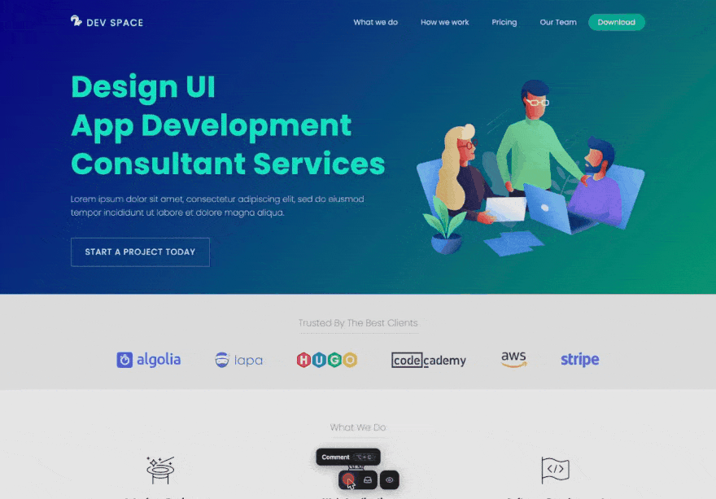

# HellDots

Drop-in comment overlay for web apps. Your team clicks anywhere on a page,
leaves a comment anchored to that element, and HellDots captures the context
needed to act on it — a screenshot, the browser, the viewport, the DOM path.

[](https://www.npmjs.com/package/helldots)
[](https://bundlejs.com/?q=helldots)
[](https://github.com/xKeCo/helldots/blob/main/LICENSE)

**[Documentation](https://helldots.kcollazos.me/docs)** ·
**[Playground](https://helldots.kcollazos.me/docs/playground)** ·
**[npm](https://www.npmjs.com/package/helldots)**



## Features

- **Anchored comments** that survive reloads and re-anchor after the page
  changes — or are marked orphaned, never silently dropped
- **Automatic context**: a screenshot, region crops, URL, viewport, browser,
  OS and the element's DOM path
- **Triage**: status, type, priority, tags, reactions and an audit trail
- **Metrics dashboard** with CSV and PDF export
- **Copy for agent**: a plain-text context block built for AI coding assistants
- **You own the data**: nothing is sent anywhere — wire the callbacks to your
  backend, or let the widget persist to `localStorage`
- **Isolated**: renders inside a Shadow DOM, framework-agnostic, typed
- **English and Spanish** built in

## Install

```bash
npm install helldots
```

> `modern-screenshot` (the screenshot renderer) is a peer dependency. npm 7+,
> pnpm 8+ and bun install it automatically; on Yarn, add it explicitly with
> `yarn add modern-screenshot`.

## Quick start

```js
import { createCommentOverlay } from "helldots";

createCommentOverlay({
  user: { name: "Ana" },
  persistence: "localStorage",
});
```

That's it. A toolbar appears at the bottom of the page. `Alt`+`C` (or
`Option`+`C` on macOS) toggles comment mode; click anywhere to leave a
comment, or drag to select a region and attach a screenshot of it.

## Wiring it to your own backend

Skip `persistence` and use the callbacks instead. `onChange` carries every
mutation as one stream; `onReady` is the safe place to restore:

```js
import { createCommentOverlay } from "helldots";

createCommentOverlay({
  user: { name: currentUser.name, id: currentUser.id },
  onChange: (event) => api.post("/helldots-events", event),
  onReady: async (overlay) => {
    overlay.loadComments(await api.get("/comments"));
  },
});
```

Every comment is plain JSON: pass `serializeComments()` output straight to
your API and hand it back to `loadComments()` later. Prefer one callback per
event (`onCommentCreated`, `onReplyAdded`, …)? They fire at the same moments —
see [Events](https://helldots.kcollazos.me/docs/api/events).

`localStorage` holds roughly a hundred comments with screenshots and assumes
one active tab per page; past that, persist through the callbacks. To keep
base64 images out of your database, upload them with `transformScreenshot`.
→ [Persistence guide](https://helldots.kcollazos.me/docs/guides/persistence)

## Frameworks

**Server-rendered apps** (Next.js, Remix, Astro…): importing is safe — nothing
touches the DOM at import time. Create the overlay on the client only:

```jsx
useEffect(() => {
  const overlay = createCommentOverlay({ user, persistence: "localStorage" });
  return () => overlay.cleanup();
}, [user]);
```

**Single-page apps**: tell the widget when a navigation happened, and let its
own cross-page jumps use your router:

```js
const overlay = createCommentOverlay({
  user,
  navigate: (page) => router.push(page),
});

router.afterEach(() => overlay.notifyNavigation());
```

→ [Frameworks guide](https://helldots.kcollazos.me/docs/guides/frameworks)

## Handing a comment to a coding agent

Every comment has a **copy** button that puts a plain-text context block on the
clipboard, built for pasting into an AI coding assistant:

```
Page: /pricing
Viewport: 1440x900
Anchor state: anchored
Status: open
Selector: #plans > div.card:nth-child(2) > button
Element: <button class="cta" data-plan="pro">
DOM path: body > main.layout > section#plans > div.card > button.cta
Nearby text: "Upgrade to Pro"
Comment by Ana (2026-07-29T10:14:00.000Z):
"This button does nothing on mobile"
Type: bug
Priority: high
Tags: checkout, ios
URL: https://example.com/pricing
Screen: 390x844
Browser: Safari 17.2
OS: iOS 17.2
```

## Common options

| Option                | Default          |                                                                   |
| --------------------- | ---------------- | ----------------------------------------------------------------- |
| `user`                | `"Anonymous"`    | `{ name, id? }` — pass `id` whenever two people can share a name  |
| `persistence`         | `"none"`         | `"localStorage"`, or handle it yourself through the callbacks     |
| `onChange`            | —                | One stream for every mutation                                     |
| `onReady`             | —                | Widget mounted; the safe place to `loadComments()`                |
| `autoScreenshot`      | `true`           | Capture a screenshot and environment snapshot per comment         |
| `transformScreenshot` | —                | Upload each image and store your URL instead of a base64 data URL |
| `can`                 | own records only | Who may edit and delete — a UI guard, not authorization           |
| `navigate`            | full page load   | SPA router hook for the widget's cross-page jumps                 |
| `locale`              | browser language | `"en"` and `"es"` ship                                            |

→ [All options](https://helldots.kcollazos.me/docs/api/options) ·
[Events](https://helldots.kcollazos.me/docs/api/events) ·
[Methods](https://helldots.kcollazos.me/docs/api/methods) ·
[Types](https://helldots.kcollazos.me/docs/api/types)

## Guides

- [Captures](https://helldots.kcollazos.me/docs/guides/captures) — what is
  recorded, web fonts, slow or very long pages, iframes, timeouts
- [Identity](https://helldots.kcollazos.me/docs/guides/identity) — `user.id`,
  who can edit and delete, and what `can` does not secure
- [Triage](https://helldots.kcollazos.me/docs/guides/triage) — status, type,
  priority, tags, reactions and the audit trail
- [Metrics](https://helldots.kcollazos.me/docs/guides/metrics) — the
  dashboard, `getMetrics()`, CSV and PDF export
- [Persistence](https://helldots.kcollazos.me/docs/guides/persistence) —
  `localStorage` limits, your own backend, screenshot uploads
- [Deep links](https://helldots.kcollazos.me/docs/guides/deep-links) —
  shareable comment URLs, and loading only the linked comment
- [Realtime](https://helldots.kcollazos.me/docs/guides/realtime) — syncing
  over a socket without echoing your own writes
- [Frameworks](https://helldots.kcollazos.me/docs/guides/frameworks) —
  server rendering, SPA routers, hotkeys, no-bundler setups, deferred mounts

## Browser support

Modern evergreen browsers. The widget renders inside a Shadow DOM, so your
page's CSS cannot leak into it and its styles cannot leak out.

## ESM only

This package ships ES modules only. `import` works everywhere — bundlers, Vite,
Next.js, Node ≥ 18, native `<script type="module">`. There is no CommonJS
build, so `require("helldots")` will not work. TypeScript definitions ship
with the package.

For a plain `<script>` tag with no bundler, a self-contained UMD build is on
the CDN:

```html
<script src="https://unpkg.com/helldots"></script>
<script>
  HellDots.createCommentOverlay({ user: { name: "Ana" } });
</script>
```

## License

MIT
